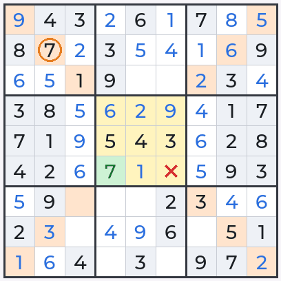

<!-- Written by tools/walkthrough.py x-sudoku: edit the script, not this page. -->
# X-Sudoku, step 34: the 7 in box 5

**Step 34 of 44** · [← Step 33](step-33.md) · [All steps](../x-sudoku.md#the-whole-puzzle-step-by-step) · [Step 35 →](step-35.md)

Box 5 needs a 7. r6c6: the main diagonal has one (r2c2). Only **r6c4** is left: **r6c4 = 7**.

**Step 34 of 44** · [← Step 33](step-33.md) · [All steps](../x-sudoku.md#the-whole-puzzle-step-by-step) · [Step 35 →](step-35.md)
