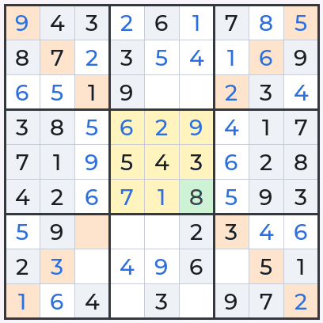

<!-- Written by tools/walkthrough.py x-sudoku: edit the script, not this page. -->
# X-Sudoku, step 35: the 8 in box 5

**Step 35 of 44** · [← Step 34](step-34.md) · [All steps](../x-sudoku.md#the-whole-puzzle-step-by-step) · [Step 36 →](step-36.md)

Box 5 needs an 8, and r6c6 is its last empty cell: **r6c6 = 8**.

**Step 35 of 44** · [← Step 34](step-34.md) · [All steps](../x-sudoku.md#the-whole-puzzle-step-by-step) · [Step 36 →](step-36.md)
