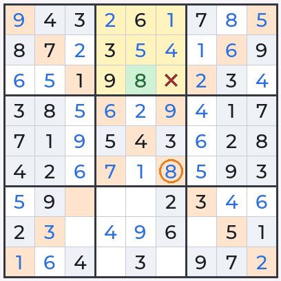

<!-- Written by tools/walkthrough.py x-sudoku: edit the script, not this page. -->
# X-Sudoku, step 36: the 8 in box 2

**Step 36 of 44** · [← Step 35](step-35.md) · [All steps](../x-sudoku.md#the-whole-puzzle-step-by-step) · [Step 37 →](step-37.md)

Box 2 needs an 8. r3c6: column 6 has one (r6c6). Only **r3c5** is left: **r3c5 = 8**.

**Step 36 of 44** · [← Step 35](step-35.md) · [All steps](../x-sudoku.md#the-whole-puzzle-step-by-step) · [Step 37 →](step-37.md)
