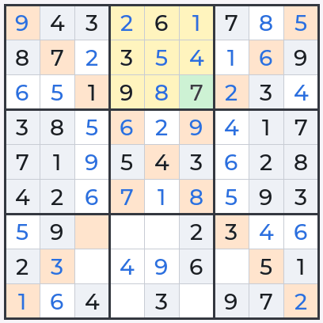

<!-- Written by tools/walkthrough.py x-sudoku: edit the script, not this page. -->
# X-Sudoku, step 37: the 7 in box 2

**Step 37 of 44** · [← Step 36](step-36.md) · [All steps](../x-sudoku.md#the-whole-puzzle-step-by-step) · [Step 38 →](step-38.md)

Box 2 needs a 7, and r3c6 is its last empty cell: **r3c6 = 7**.

**Step 37 of 44** · [← Step 36](step-36.md) · [All steps](../x-sudoku.md#the-whole-puzzle-step-by-step) · [Step 38 →](step-38.md)
