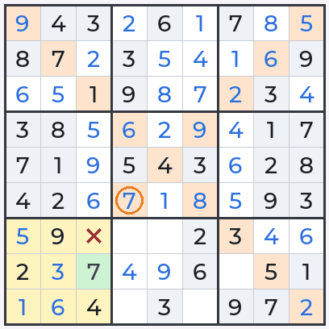

<!-- Written by tools/walkthrough.py x-sudoku: edit the script, not this page. -->
# X-Sudoku, step 38: the 7 in box 7

**Step 38 of 44** · [← Step 37](step-37.md) · [All steps](../x-sudoku.md#the-whole-puzzle-step-by-step) · [Step 39 →](step-39.md)

Box 7 needs a 7. r7c3: the anti-diagonal has one (r6c4). Only **r8c3** is left: **r8c3 = 7**.

**Step 38 of 44** · [← Step 37](step-37.md) · [All steps](../x-sudoku.md#the-whole-puzzle-step-by-step) · [Step 39 →](step-39.md)
