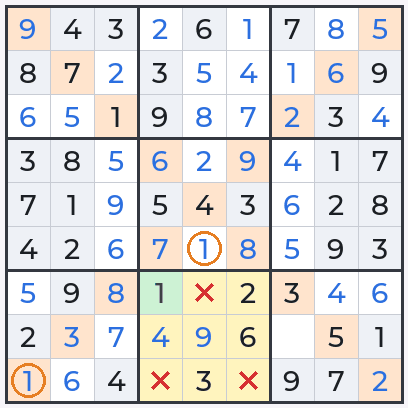

<!-- Written by tools/walkthrough.py x-sudoku: edit the script, not this page. -->
# X-Sudoku, step 40: the 1 in box 8

**Step 40 of 44** · [← Step 39](step-39.md) · [All steps](../x-sudoku.md#the-whole-puzzle-step-by-step) · [Step 41 →](step-41.md)

Box 8 needs a 1. r7c5: column 5 has one (r6c5). r9c4 and r9c6: row 9 has one (r9c1). Only **r7c4** is left: **r7c4 = 1**.

**Step 40 of 44** · [← Step 39](step-39.md) · [All steps](../x-sudoku.md#the-whole-puzzle-step-by-step) · [Step 41 →](step-41.md)
