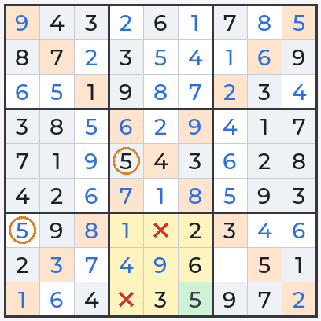

<!-- Written by tools/walkthrough.py x-sudoku: edit the script, not this page. -->
# X-Sudoku, step 41: the 5 in box 8

**Step 41 of 44** · [← Step 40](step-40.md) · [All steps](../x-sudoku.md#the-whole-puzzle-step-by-step) · [Step 42 →](step-42.md)

Box 8 needs a 5. r7c5: row 7 has one (r7c1). r9c4: column 4 has one (r5c4). Only **r9c6** is left: **r9c6 = 5**.

**Step 41 of 44** · [← Step 40](step-40.md) · [All steps](../x-sudoku.md#the-whole-puzzle-step-by-step) · [Step 42 →](step-42.md)
