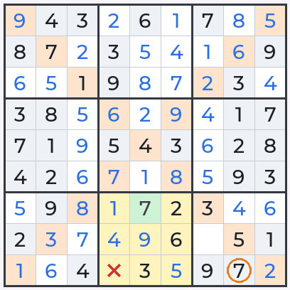

<!-- Written by tools/walkthrough.py x-sudoku: edit the script, not this page. -->
# X-Sudoku, step 42: the 7 in box 8

**Step 42 of 44** · [← Step 41](step-41.md) · [All steps](../x-sudoku.md#the-whole-puzzle-step-by-step) · [Step 43 →](step-43.md)

Box 8 needs a 7. r9c4: row 9 has one (r9c8). Only **r7c5** is left: **r7c5 = 7**.

**Step 42 of 44** · [← Step 41](step-41.md) · [All steps](../x-sudoku.md#the-whole-puzzle-step-by-step) · [Step 43 →](step-43.md)
