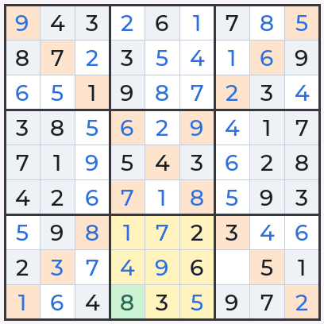

<!-- Written by tools/walkthrough.py x-sudoku: edit the script, not this page. -->
# X-Sudoku, step 43: the 8 in box 8

**Step 43 of 44** · [← Step 42](step-42.md) · [All steps](../x-sudoku.md#the-whole-puzzle-step-by-step) · [Step 44 →](step-44.md)

Box 8 needs an 8, and r9c4 is its last empty cell: **r9c4 = 8**.

**Step 43 of 44** · [← Step 42](step-42.md) · [All steps](../x-sudoku.md#the-whole-puzzle-step-by-step) · [Step 44 →](step-44.md)
