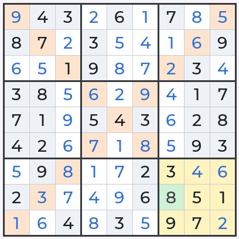

<!-- Written by tools/walkthrough.py x-sudoku: edit the script, not this page. -->
# X-Sudoku, step 44: the 8 in box 9

**Step 44 of 44** · [← Step 43](step-43.md) · [All steps](../x-sudoku.md#the-whole-puzzle-step-by-step) · [All steps](../x-sudoku.md#the-whole-puzzle-step-by-step)

Box 9 needs an 8, and r8c7 is its last empty cell: **r8c7 = 8**.

Solved.

**Step 44 of 44** · [← Step 43](step-43.md) · [All steps](../x-sudoku.md#the-whole-puzzle-step-by-step) · [All steps](../x-sudoku.md#the-whole-puzzle-step-by-step)
