# X-Sums

[← All variants](README.md) · [Puzzles](../features-puzzles.md) · [How to play](../how-to-play.md)

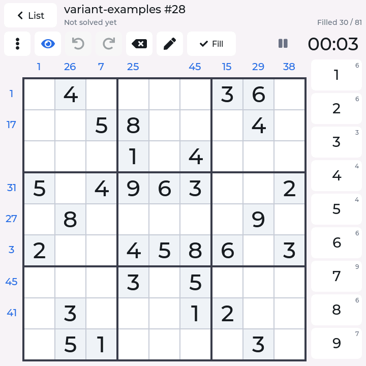

## The rules

[Classic](classic.md) rules, and **clues** left of some rows and above some columns. Read the row from the left (the column from the top): its **first digit is X**, and the clue is **the sum of the first X digits**, the first one included. In 3, 4, 2, 9, 8 the first digit is 3, so the clue is 3 + 4 + 2 = 9. A line without a clue has no such rule.

## On the board

- The clues are in blue in a margin left of the rows and above the columns; a line without a clue has none.
- Once a line's first digit is in, its first X digits turn red when they already add up to more than the clue, or (all filled) to something else.
- The grader and hints try each first digit a clue still allows against the digits there: "The clue of row 4 is 31: the first digit from there says how many digits add up to it ...".
- **Puzzles → ⋮ → New puzzle → X-Sums**: about three quarters of the lines have a clue (Hard and Expert: about 60 %).

## How to solve it

- **A clue of 1:** the line starts with 1 (a 1 counts just itself). **A clue of 45:** it starts with 9 (all nine digits).
- **Each first digit X has a range:** X = 2 makes 3 to 11, X = 3 makes 6 to 20 (3 + 1 + 2 up to 3 + 9 + 8), X = 4 makes 10 to 28, and so on. A clue rules out every X whose range misses it; a clue of 2 can't happen.
- **Once X is known, it's a cage:** the first X cells add up to the clue, with no repeats (they're in one row or column). The cells after them are free.
- **Big clues, big X:** a clue of 35 needs at least 6 digits, so the line starts with 6 to 9.

## Worked example

**variant-examples #28**, X-Sums Easy (see [Classic](classic.md#worked-example-the-whole-puzzle) for how to import the examples; cells are written r*row*c*column*). The clues are in the picture; from the left, row 4's is **31**; from the top, column 4's is **25** and column 8's **29**.

**Step 1: r4c2, row 4 (clue 31).** Row 4 reads 5, ., 4, 9, 6, 3, ., ., 2; by the Classic rules r4c2 could be 1 or 7. The row starts with 5, so its first five digits add up to 31: 5 + r4c2 + 4 + 9 + 6 = 24 + r4c2. **r4c2 = 7**.

**Step 2: r4c8, column 8 (clue 29).** Row 4 now misses 1 and 8. Column 8 starts with 6, so its first six digits add up to 29: 6, 4, r3c8, r4c8, 9 and r6c8. That's 19 already, leaving 10 for r3c8, r4c8 and r6c8. With an 8 in r4c8 the other two would need 2 between them: impossible with two different digits. **r4c8 = 1**.

**Step 3: r5c4, column 4 (clue 25).** Row 5 has 8 and 9; column 4 has 1, 3, 4, 8 and 9; box 5 has 5 and 6: that leaves 2 and 7. Column 4 reads ., 8, 1, 9, r5c4, 4, 3 from the top, and its first cell can only be 2, 5, 6 or 7. With a 7 in r5c4, the first cell is 2, 5 or 6: starting with 2 gives 2 + 8 = 10; with 5, 5 + 8 + 1 + 9 + 7 = 30; with 6, 6 + 8 + 1 + 9 + 7 + 4 = 35. None is 25. **r5c4 = 2** (and then the column starts with 5: 5 + 8 + 1 + 9 + 2 = 25).

## The whole puzzle, step by step

<!-- walkthrough -->
<!-- Written by tools/walkthrough.py x-sums: edit the script, not this part. -->

The whole puzzle, from the start to the last cell: 51 steps, each one a single (one place left for a digit, or one digit left for a cell), taken in the order a box's single comes first, so not quite the order of the worked example above. In each picture, the unit the step looks at is tinted yellow (for a cell with one digit left: its row, column and box), the new digit is on green, the digits that rule cells out have an **orange ring**, and the empty cells they rule out a **red cross**. Givens are on grey, digits from earlier steps in blue.

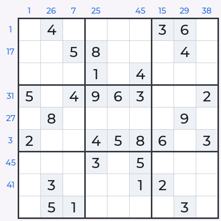

#### Step 1: the 1 in box 1

Box 1 needs a 1. r1c3: column 3 has one (r9c3). r3c1, r3c2 and r3c3: row 3 has one (r3c4). r2c1: it's the first cell after a clue, and that clue can only start with 3 to 5. r2c2: Row 2's clue 17 can't be made up with a 1 there, whatever its first digit. Only **r1c1** is left: **r1c1 = 1**.

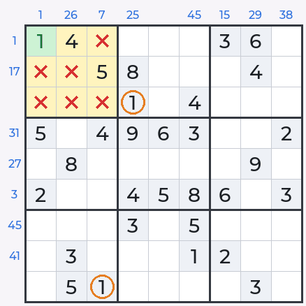

#### Step 2: the 5 in box 2

Box 2 needs a 5. r1c5 and r3c5: column 5 has one (r6c5). r1c6: column 6 has one (r7c6). r2c5 and r2c6: row 2 has one (r2c3). Only **r1c4** is left: **r1c4 = 5**.

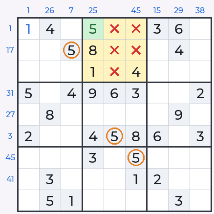

#### Step 3: the 6 in box 2

Box 2 needs a 6. r1c5 and r1c6: row 1 has one (r1c8). r2c5 and r3c5: column 5 has one (r4c5). Only **r2c6** is left: **r2c6 = 6**.

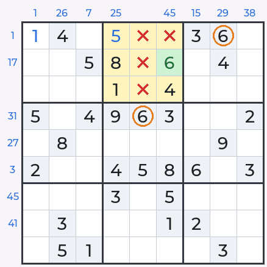

#### Step 4: the 1 in box 3

Box 3 needs a 1. r1c9: row 1 has one (r1c1). r3c7, r3c8 and r3c9: row 3 has one (r3c4). r2c7: Column 7 starts with a 3, so its first 3 digits add up to its clue 15: with a 1 there, its other empty cell would need 11, which can't be made with digits not there yet. Only **r2c9** is left: **r2c9 = 1**.

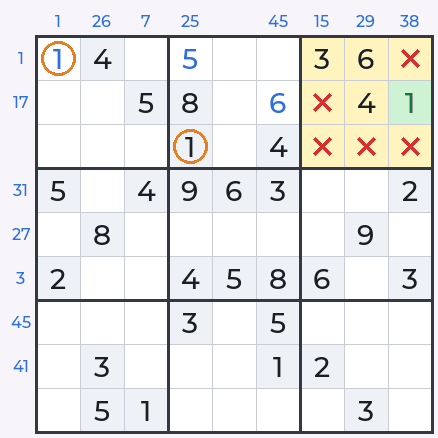

#### Step 5: the 2 in box 3

Box 3 needs a 2. r1c9 and r3c9: column 9 has one (r4c9). r2c7 and r3c7: column 7 has one (r8c7). Only **r3c8** is left: **r3c8 = 2**.

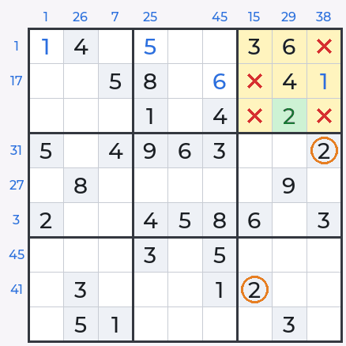

#### Step 6: the 2 in box 1

Box 1 needs a 2. r2c1: column 1 has one (r6c1). r3c1, r3c2 and r3c3: row 3 has one (r3c8). r2c2: Row 2's clue 17 can't be made up with a 2 there, whatever its first digit. Only **r1c3** is left: **r1c3 = 2**.

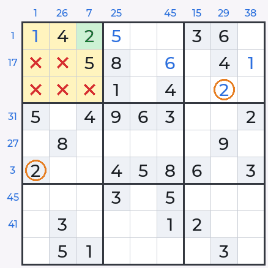

#### Step 7: the 2 in box 2

Box 2 needs a 2. r1c5 and r1c6: row 1 has one (r1c3). r3c5: row 3 has one (r3c8). Only **r2c5** is left: **r2c5 = 2**.

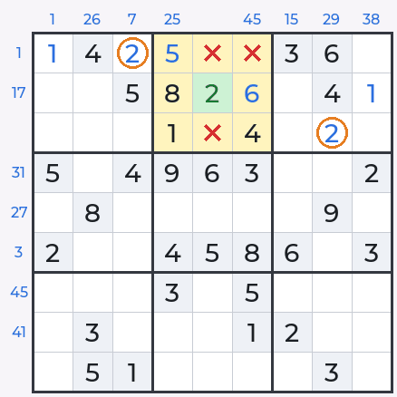

#### Step 8: the 3 in box 2

Box 2 needs a 3. r1c5 and r1c6: row 1 has one (r1c7). Only **r3c5** is left: **r3c5 = 3**.

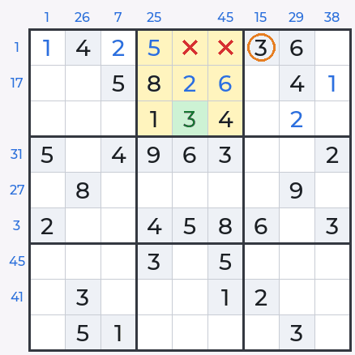

#### Step 9: the 3 in box 1

Box 1 needs a 3. r2c2: column 2 has one (r8c2). r3c1, r3c2 and r3c3: row 3 has one (r3c5). Only **r2c1** is left: **r2c1 = 3**.

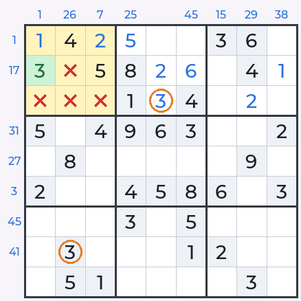

#### Step 10: the 7 in box 2

Box 2 needs a 7. r1c6: it's the first cell after a clue, and that clue can only start with a 9. Only **r1c5** is left: **r1c5 = 7**.

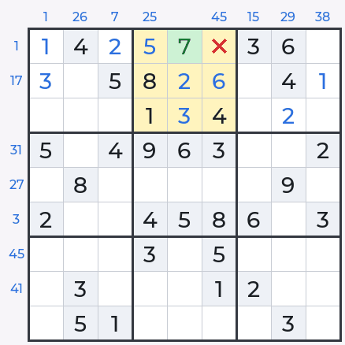

#### Step 11: the 9 in box 2

Box 2 needs a 9, and r1c6 is its last empty cell: **r1c6 = 9**.

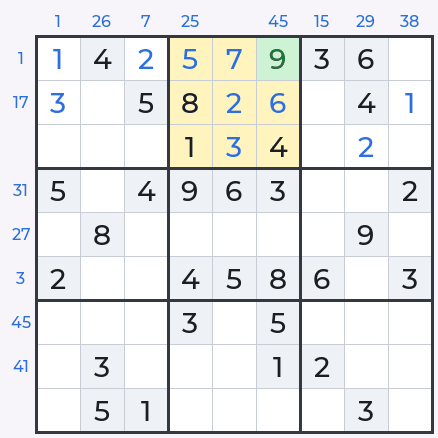

#### Step 12: the 1 in box 4

Box 4 needs a 1. r5c1: column 1 has one (r1c1). r5c3 and r6c3: column 3 has one (r9c3). r4c2: Row 4 starts with a 5, so its first 5 digits add up to its clue 31, but with a 1 there they come to 25. Only **r6c2** is left: **r6c2 = 1**.

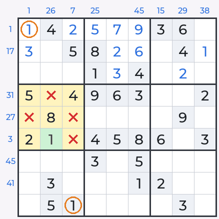

#### Step 13: the 3 in box 4

Box 4 needs a 3. r4c2: row 4 has one (r4c6). r5c1: column 1 has one (r2c1). r6c3: row 6 has one (r6c9). Only **r5c3** is left: **r5c3 = 3**.

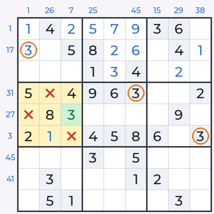

#### Step 14: the 6 in box 4

Box 4 needs a 6. r4c2: row 4 has one (r4c5). r6c3: row 6 has one (r6c7). Only **r5c1** is left: **r5c1 = 6**.

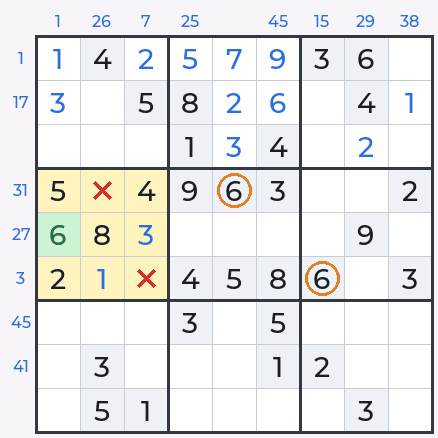

#### Step 15: the 9 in box 4

Box 4 needs a 9. r4c2: row 4 has one (r4c4). Only **r6c3** is left: **r6c3 = 9**.

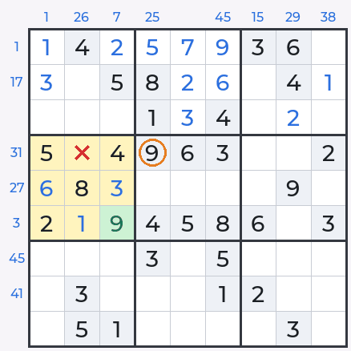

#### Step 16: the 7 in box 4

Box 4 needs a 7, and r4c2 is its last empty cell: **r4c2 = 7**.

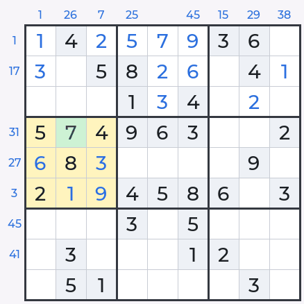

#### Step 17: the 1 in box 5

Box 5 needs a 1. r5c4: column 4 has one (r3c4). r5c6: column 6 has one (r8c6). Only **r5c5** is left: **r5c5 = 1**.

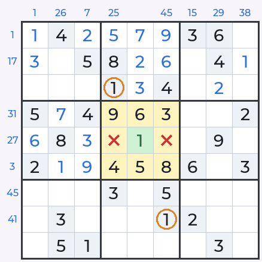

#### Step 18: the 7 in box 5

Box 5 needs a 7. r5c4: Column 4 starts with a 5, so its first 5 digits add up to its clue 25, but with a 7 there they come to 30. Only **r5c6** is left: **r5c6 = 7**.

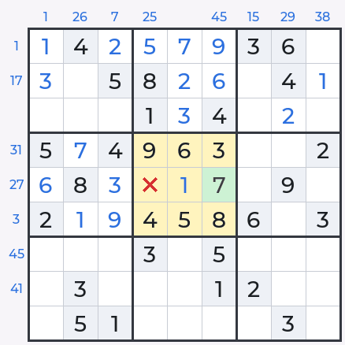

#### Step 19: the 2 in box 5

Box 5 needs a 2, and r5c4 is its last empty cell: **r5c4 = 2**.

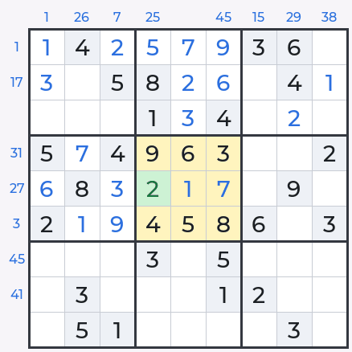

#### Step 20: the 7 in box 6

Box 6 needs a 7. r4c7 and r4c8: row 4 has one (r4c2). r5c7 and r5c9: row 5 has one (r5c6). Only **r6c8** is left: **r6c8 = 7**.

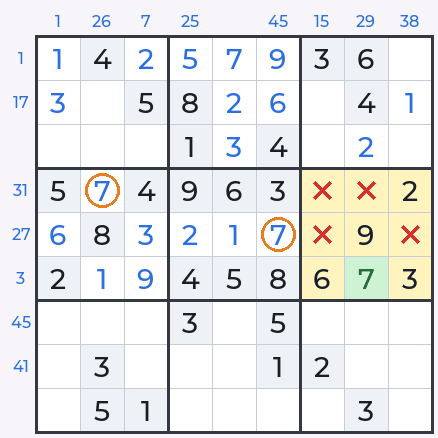

#### Step 21: the 8 in box 6

Box 6 needs an 8. r5c7 and r5c9: row 5 has one (r5c2). r4c8: Column 8 starts with a 6, so its first 6 digits add up to its clue 29, but with an 8 there they come to 36. Only **r4c7** is left: **r4c7 = 8**.

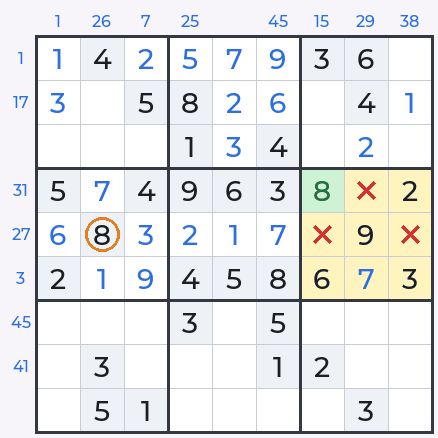

#### Step 22: the 8 in box 3

Box 3 needs an 8. r2c7: row 2 has one (r2c4). r3c7: column 7 has one (r4c7). r3c9: Column 9's clue 38 can't be made up with an 8 there, whatever its first digit. Only **r1c9** is left: **r1c9 = 8**.

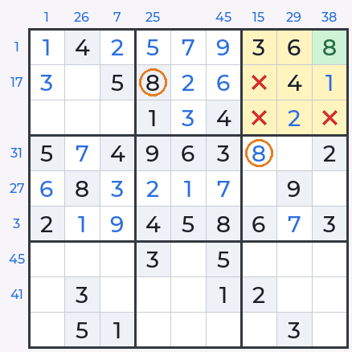

#### Step 23: the 1 in box 6

Box 6 needs a 1. r5c7 and r5c9: row 5 has one (r5c5). Only **r4c8** is left: **r4c8 = 1**.

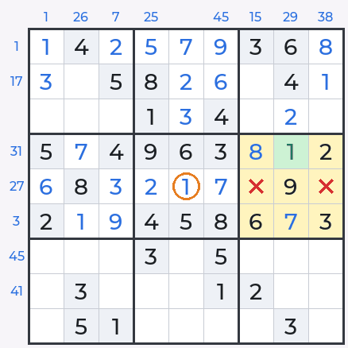

#### Step 24: the 2 in box 7

Box 7 needs a 2. r7c1 and r9c1: column 1 has one (r6c1). r7c3: column 3 has one (r1c3). r8c1 and r8c3: row 8 has one (r8c7). Only **r7c2** is left: **r7c2 = 2**.

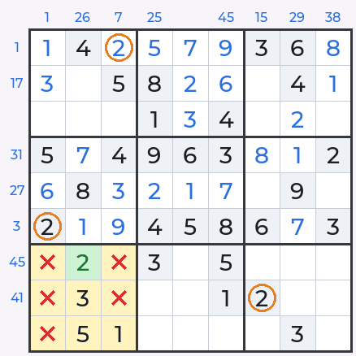

#### Step 25: the 4 in box 7

Box 7 needs a 4. r7c3 and r8c3: column 3 has one (r4c3). r7c1: it's the first cell after a clue, and that clue can only start with a 9. r8c1: it's the first cell after a clue, and that clue can only start with 7 to 8. Only **r9c1** is left: **r9c1 = 4**.

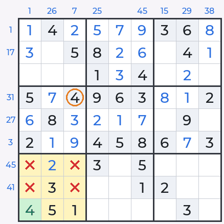

#### Step 26: the 9 in box 7

Box 7 needs a 9. r7c3 and r8c3: column 3 has one (r6c3). r8c1: it's the first cell after a clue, and that clue can only start with 7 to 8. Only **r7c1** is left: **r7c1 = 9**.

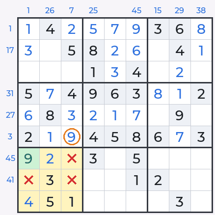

#### Step 27: the 2 in box 8

Box 8 needs a 2. r7c5: row 7 has one (r7c2). r8c4 and r8c5: row 8 has one (r8c7). r9c4: column 4 has one (r5c4). r9c5: column 5 has one (r2c5). Only **r9c6** is left: **r9c6 = 2**.

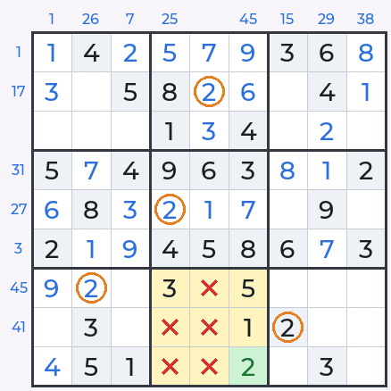

#### Step 28: the 4 in box 8

Box 8 needs a 4. r8c4: column 4 has one (r6c4). r9c4 and r9c5: row 9 has one (r9c1). r8c5: Row 8's clue 41 can't be made up with a 4 there, whatever its first digit. Only **r7c5** is left: **r7c5 = 4**.

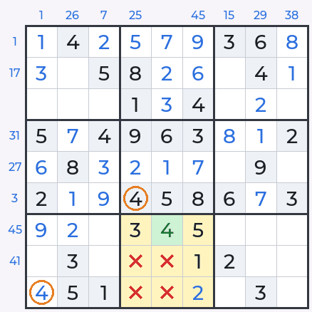

#### Step 29: the 8 in box 8

Box 8 needs an 8. r8c4 and r9c4: column 4 has one (r2c4). r8c5: Row 8's clue 41 can't be made up with an 8 there, whatever its first digit. Only **r9c5** is left: **r9c5 = 8**.

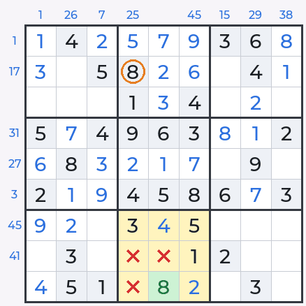

#### Step 30: the 9 in box 8

Box 8 needs a 9. r8c4 and r9c4: column 4 has one (r4c4). Only **r8c5** is left: **r8c5 = 9**.

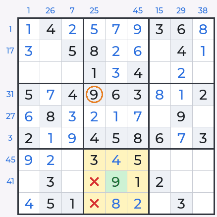

#### Step 31: the 1 in box 9

Box 9 needs a 1. r7c8: column 8 has one (r4c8). r7c9: column 9 has one (r2c9). r8c8 and r8c9: row 8 has one (r8c6). r9c7 and r9c9: row 9 has one (r9c3). Only **r7c7** is left: **r7c7 = 1**.

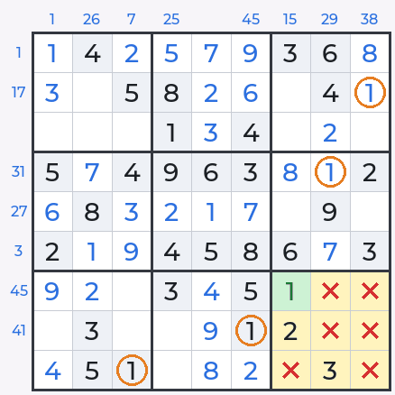

#### Step 32: the 9 in box 3

Box 3 needs a 9. r2c7 and r3c7: Column 7 starts with a 3, so its first 3 digits add up to its clue 15: with a 9 there, its other empty cell would need 3, which can't be made with digits not there yet. Only **r3c9** is left: **r3c9 = 9**.

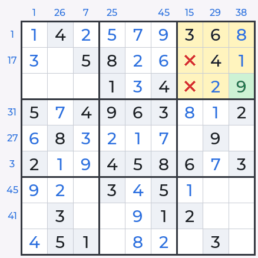

#### Step 33: the 9 in box 1

Box 1 needs a 9. r3c1, r3c2 and r3c3: row 3 has one (r3c9). Only **r2c2** is left: **r2c2 = 9**.

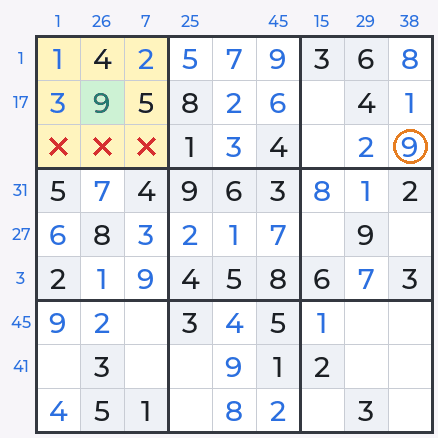

#### Step 34: the 5 in box 3

Box 3 needs a 5. r2c7: row 2 has one (r2c3). Only **r3c7** is left: **r3c7 = 5**.

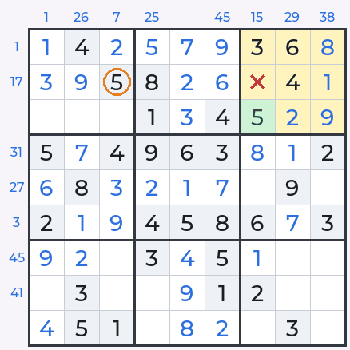

#### Step 35: the 7 in box 3

Box 3 needs a 7, and r2c7 is its last empty cell: **r2c7 = 7**.

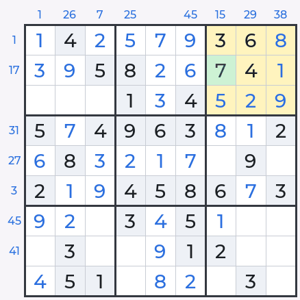

#### Step 36: the 5 in box 6

Box 6 needs a 5. r5c7: column 7 has one (r3c7). Only **r5c9** is left: **r5c9 = 5**.

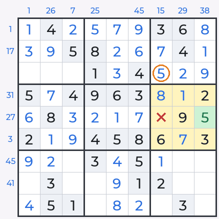

#### Step 37: the 4 in box 6

Box 6 needs a 4, and r5c7 is its last empty cell: **r5c7 = 4**.

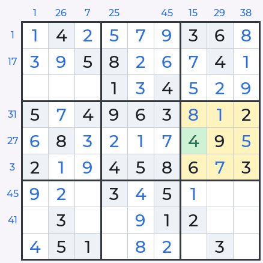

#### Step 38: the 4 in box 9

Box 9 needs a 4. r7c8 and r7c9: row 7 has one (r7c5). r8c8: column 8 has one (r2c8). r9c7 and r9c9: row 9 has one (r9c1). Only **r8c9** is left: **r8c9 = 4**.

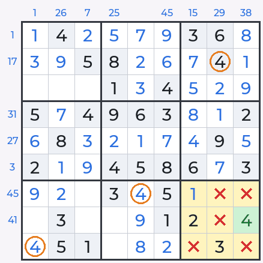

#### Step 39: the 5 in box 9

Box 9 needs a 5. r7c8 and r7c9: row 7 has one (r7c6). r9c7 and r9c9: row 9 has one (r9c2). Only **r8c8** is left: **r8c8 = 5**.

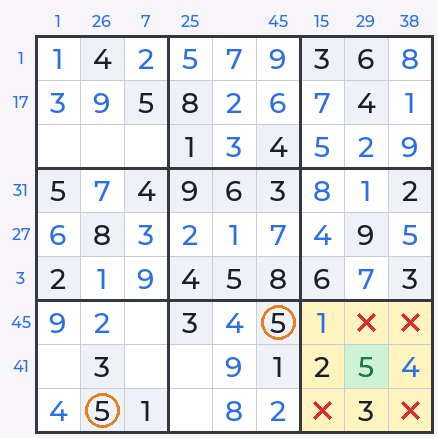

#### Step 40: the 7 in box 9

Box 9 needs a 7. r7c8: column 8 has one (r6c8). r9c7: column 7 has one (r2c7). r7c9: Column 9 starts with an 8, so its first 8 digits add up to its clue 38, but with a 7 there they come to 39. Only **r9c9** is left: **r9c9 = 7**.

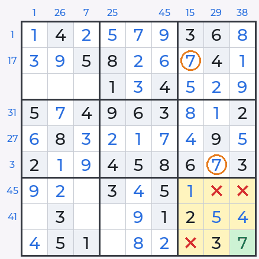

#### Step 41: the 7 in box 8

Box 8 needs a 7. r9c4: row 9 has one (r9c9). Only **r8c4** is left: **r8c4 = 7**.

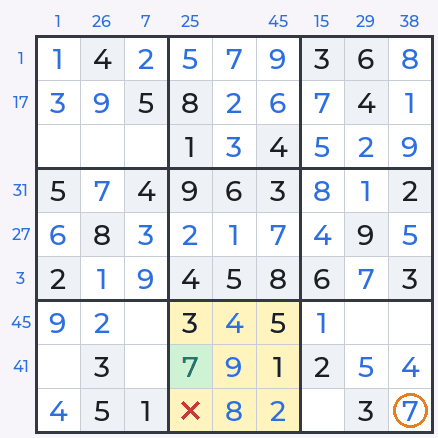

#### Step 42: the 7 in box 7

Box 7 needs a 7. r8c1 and r8c3: row 8 has one (r8c4). Only **r7c3** is left: **r7c3 = 7**.

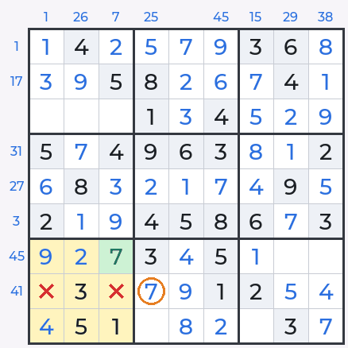

#### Step 43: the 7 in box 1

Box 1 needs a 7. r3c2: column 2 has one (r4c2). r3c3: column 3 has one (r7c3). Only **r3c1** is left: **r3c1 = 7**.

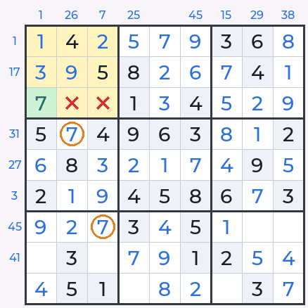

#### Step 44: the 8 in box 1

Box 1 needs an 8. r3c2: column 2 has one (r5c2). Only **r3c3** is left: **r3c3 = 8**.

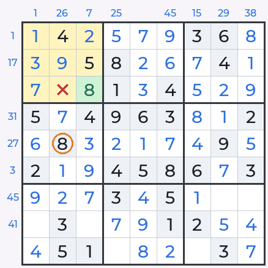

#### Step 45: the 6 in box 1

Box 1 needs a 6, and r3c2 is its last empty cell: **r3c2 = 6**.

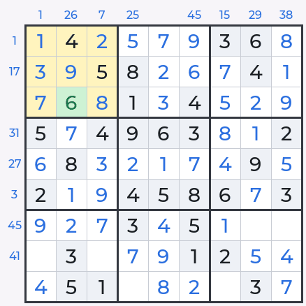

#### Step 46: the 6 in box 7

Box 7 needs a 6. r8c1: column 1 has one (r5c1). Only **r8c3** is left: **r8c3 = 6**.

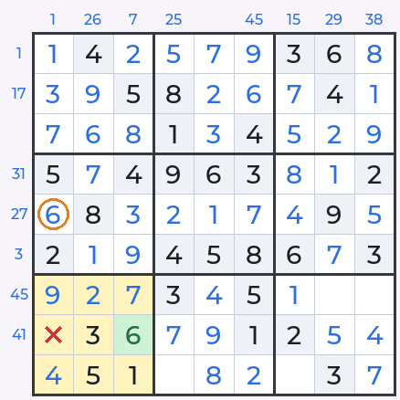

#### Step 47: the 8 in box 7

Box 7 needs an 8, and r8c1 is its last empty cell: **r8c1 = 8**.

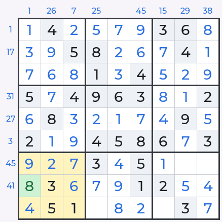

#### Step 48: the 6 in box 8

Box 8 needs a 6, and r9c4 is its last empty cell: **r9c4 = 6**.

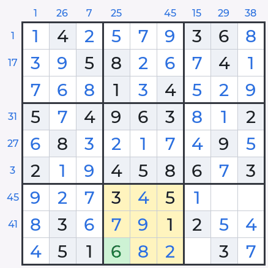

#### Step 49: the 6 in box 9

Box 9 needs a 6. r7c8: column 8 has one (r1c8). r9c7: row 9 has one (r9c4). Only **r7c9** is left: **r7c9 = 6**.

#### Step 50: the 8 in box 9

Box 9 needs an 8. r9c7: row 9 has one (r9c5). Only **r7c8** is left: **r7c8 = 8**.

#### Step 51: the 9 in box 9

Box 9 needs a 9, and r9c7 is its last empty cell: **r9c7 = 9**.

Solved.

<!-- /walkthrough -->
