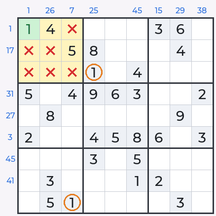

<!-- Written by tools/walkthrough.py x-sums: edit the script, not this page. -->
# X-Sums, step 1: the 1 in box 1

**Step 1 of 51** · [← The start](../x-sums.md#the-whole-puzzle-step-by-step) · [All steps](../x-sums.md#the-whole-puzzle-step-by-step) · [Step 2 →](step-02.md)

Box 1 needs a 1. r1c3: column 3 has one (r9c3). r3c1, r3c2 and r3c3: row 3 has one (r3c4). r2c1: it's the first cell after a clue, and that clue can only start with 3 to 5. r2c2: Row 2's clue 17 can't be made up with a 1 there, whatever its first digit. Only **r1c1** is left: **r1c1 = 1**.

**Step 1 of 51** · [← The start](../x-sums.md#the-whole-puzzle-step-by-step) · [All steps](../x-sums.md#the-whole-puzzle-step-by-step) · [Step 2 →](step-02.md)
