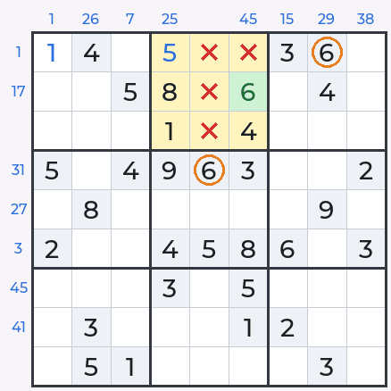

<!-- Written by tools/walkthrough.py x-sums: edit the script, not this page. -->
# X-Sums, step 3: the 6 in box 2

**Step 3 of 51** · [← Step 2](step-02.md) · [All steps](../x-sums.md#the-whole-puzzle-step-by-step) · [Step 4 →](step-04.md)

Box 2 needs a 6. r1c5 and r1c6: row 1 has one (r1c8). r2c5 and r3c5: column 5 has one (r4c5). Only **r2c6** is left: **r2c6 = 6**.

**Step 3 of 51** · [← Step 2](step-02.md) · [All steps](../x-sums.md#the-whole-puzzle-step-by-step) · [Step 4 →](step-04.md)
