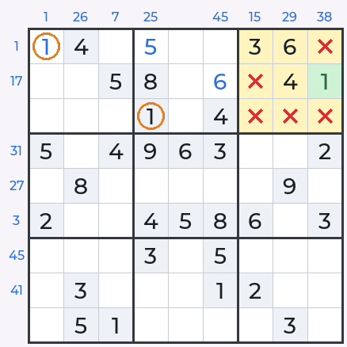

<!-- Written by tools/walkthrough.py x-sums: edit the script, not this page. -->
# X-Sums, step 4: the 1 in box 3

**Step 4 of 51** · [← Step 3](step-03.md) · [All steps](../x-sums.md#the-whole-puzzle-step-by-step) · [Step 5 →](step-05.md)

Box 3 needs a 1. r1c9: row 1 has one (r1c1). r3c7, r3c8 and r3c9: row 3 has one (r3c4). r2c7: Column 7 starts with a 3, so its first 3 digits add up to its clue 15: with a 1 there, its other empty cell would need 11, which can't be made with digits not there yet. Only **r2c9** is left: **r2c9 = 1**.

**Step 4 of 51** · [← Step 3](step-03.md) · [All steps](../x-sums.md#the-whole-puzzle-step-by-step) · [Step 5 →](step-05.md)
