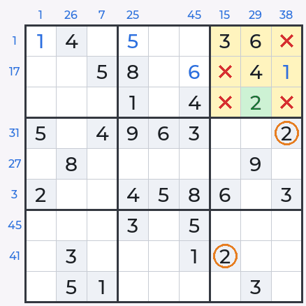

<!-- Written by tools/walkthrough.py x-sums: edit the script, not this page. -->
# X-Sums, step 5: the 2 in box 3

**Step 5 of 51** · [← Step 4](step-04.md) · [All steps](../x-sums.md#the-whole-puzzle-step-by-step) · [Step 6 →](step-06.md)

Box 3 needs a 2. r1c9 and r3c9: column 9 has one (r4c9). r2c7 and r3c7: column 7 has one (r8c7). Only **r3c8** is left: **r3c8 = 2**.

**Step 5 of 51** · [← Step 4](step-04.md) · [All steps](../x-sums.md#the-whole-puzzle-step-by-step) · [Step 6 →](step-06.md)
