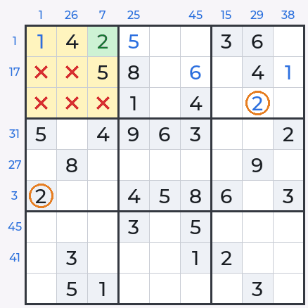

<!-- Written by tools/walkthrough.py x-sums: edit the script, not this page. -->
# X-Sums, step 6: the 2 in box 1

**Step 6 of 51** · [← Step 5](step-05.md) · [All steps](../x-sums.md#the-whole-puzzle-step-by-step) · [Step 7 →](step-07.md)

Box 1 needs a 2. r2c1: column 1 has one (r6c1). r3c1, r3c2 and r3c3: row 3 has one (r3c8). r2c2: Row 2's clue 17 can't be made up with a 2 there, whatever its first digit. Only **r1c3** is left: **r1c3 = 2**.

**Step 6 of 51** · [← Step 5](step-05.md) · [All steps](../x-sums.md#the-whole-puzzle-step-by-step) · [Step 7 →](step-07.md)
