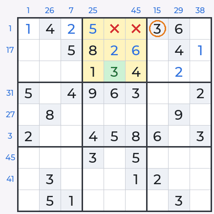

<!-- Written by tools/walkthrough.py x-sums: edit the script, not this page. -->
# X-Sums, step 8: the 3 in box 2

**Step 8 of 51** · [← Step 7](step-07.md) · [All steps](../x-sums.md#the-whole-puzzle-step-by-step) · [Step 9 →](step-09.md)

Box 2 needs a 3. r1c5 and r1c6: row 1 has one (r1c7). Only **r3c5** is left: **r3c5 = 3**.

**Step 8 of 51** · [← Step 7](step-07.md) · [All steps](../x-sums.md#the-whole-puzzle-step-by-step) · [Step 9 →](step-09.md)
