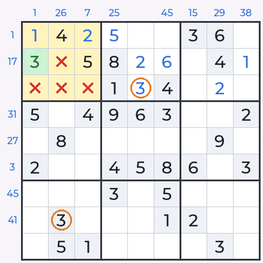

<!-- Written by tools/walkthrough.py x-sums: edit the script, not this page. -->
# X-Sums, step 9: the 3 in box 1

**Step 9 of 51** · [← Step 8](step-08.md) · [All steps](../x-sums.md#the-whole-puzzle-step-by-step) · [Step 10 →](step-10.md)

Box 1 needs a 3. r2c2: column 2 has one (r8c2). r3c1, r3c2 and r3c3: row 3 has one (r3c5). Only **r2c1** is left: **r2c1 = 3**.

**Step 9 of 51** · [← Step 8](step-08.md) · [All steps](../x-sums.md#the-whole-puzzle-step-by-step) · [Step 10 →](step-10.md)
