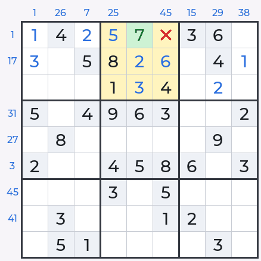

<!-- Written by tools/walkthrough.py x-sums: edit the script, not this page. -->
# X-Sums, step 10: the 7 in box 2

**Step 10 of 51** · [← Step 9](step-09.md) · [All steps](../x-sums.md#the-whole-puzzle-step-by-step) · [Step 11 →](step-11.md)

Box 2 needs a 7. r1c6: it's the first cell after a clue, and that clue can only start with a 9. Only **r1c5** is left: **r1c5 = 7**.

**Step 10 of 51** · [← Step 9](step-09.md) · [All steps](../x-sums.md#the-whole-puzzle-step-by-step) · [Step 11 →](step-11.md)
