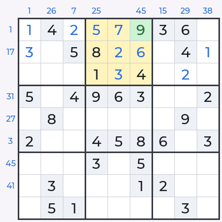

<!-- Written by tools/walkthrough.py x-sums: edit the script, not this page. -->
# X-Sums, step 11: the 9 in box 2

**Step 11 of 51** · [← Step 10](step-10.md) · [All steps](../x-sums.md#the-whole-puzzle-step-by-step) · [Step 12 →](step-12.md)

Box 2 needs a 9, and r1c6 is its last empty cell: **r1c6 = 9**.

**Step 11 of 51** · [← Step 10](step-10.md) · [All steps](../x-sums.md#the-whole-puzzle-step-by-step) · [Step 12 →](step-12.md)
