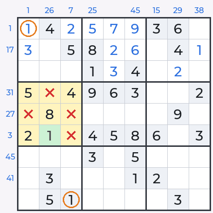

<!-- Written by tools/walkthrough.py x-sums: edit the script, not this page. -->
# X-Sums, step 12: the 1 in box 4

**Step 12 of 51** · [← Step 11](step-11.md) · [All steps](../x-sums.md#the-whole-puzzle-step-by-step) · [Step 13 →](step-13.md)

Box 4 needs a 1. r5c1: column 1 has one (r1c1). r5c3 and r6c3: column 3 has one (r9c3). r4c2: Row 4 starts with a 5, so its first 5 digits add up to its clue 31, but with a 1 there they come to 25. Only **r6c2** is left: **r6c2 = 1**.

**Step 12 of 51** · [← Step 11](step-11.md) · [All steps](../x-sums.md#the-whole-puzzle-step-by-step) · [Step 13 →](step-13.md)
