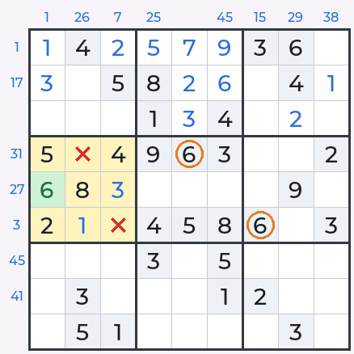

<!-- Written by tools/walkthrough.py x-sums: edit the script, not this page. -->
# X-Sums, step 14: the 6 in box 4

**Step 14 of 51** · [← Step 13](step-13.md) · [All steps](../x-sums.md#the-whole-puzzle-step-by-step) · [Step 15 →](step-15.md)

Box 4 needs a 6. r4c2: row 4 has one (r4c5). r6c3: row 6 has one (r6c7). Only **r5c1** is left: **r5c1 = 6**.

**Step 14 of 51** · [← Step 13](step-13.md) · [All steps](../x-sums.md#the-whole-puzzle-step-by-step) · [Step 15 →](step-15.md)
