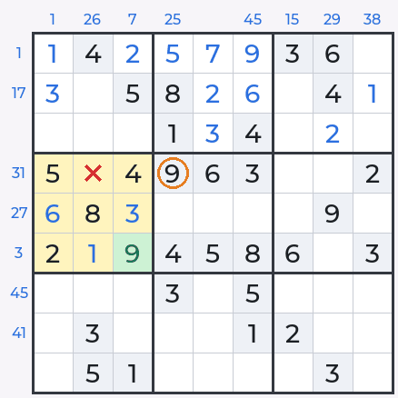

<!-- Written by tools/walkthrough.py x-sums: edit the script, not this page. -->
# X-Sums, step 15: the 9 in box 4

**Step 15 of 51** · [← Step 14](step-14.md) · [All steps](../x-sums.md#the-whole-puzzle-step-by-step) · [Step 16 →](step-16.md)

Box 4 needs a 9. r4c2: row 4 has one (r4c4). Only **r6c3** is left: **r6c3 = 9**.

**Step 15 of 51** · [← Step 14](step-14.md) · [All steps](../x-sums.md#the-whole-puzzle-step-by-step) · [Step 16 →](step-16.md)
