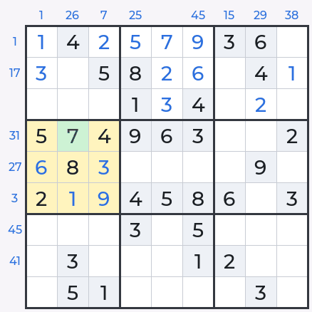

<!-- Written by tools/walkthrough.py x-sums: edit the script, not this page. -->
# X-Sums, step 16: the 7 in box 4

**Step 16 of 51** · [← Step 15](step-15.md) · [All steps](../x-sums.md#the-whole-puzzle-step-by-step) · [Step 17 →](step-17.md)

Box 4 needs a 7, and r4c2 is its last empty cell: **r4c2 = 7**.

**Step 16 of 51** · [← Step 15](step-15.md) · [All steps](../x-sums.md#the-whole-puzzle-step-by-step) · [Step 17 →](step-17.md)
