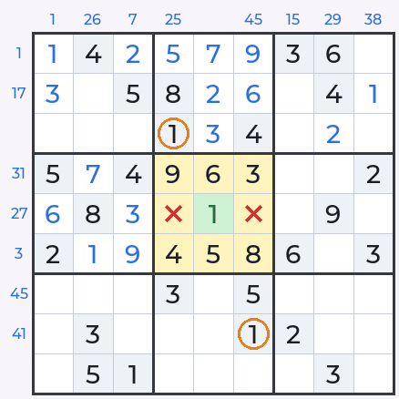

<!-- Written by tools/walkthrough.py x-sums: edit the script, not this page. -->
# X-Sums, step 17: the 1 in box 5

**Step 17 of 51** · [← Step 16](step-16.md) · [All steps](../x-sums.md#the-whole-puzzle-step-by-step) · [Step 18 →](step-18.md)

Box 5 needs a 1. r5c4: column 4 has one (r3c4). r5c6: column 6 has one (r8c6). Only **r5c5** is left: **r5c5 = 1**.

**Step 17 of 51** · [← Step 16](step-16.md) · [All steps](../x-sums.md#the-whole-puzzle-step-by-step) · [Step 18 →](step-18.md)
