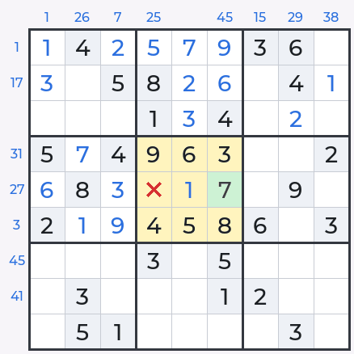

<!-- Written by tools/walkthrough.py x-sums: edit the script, not this page. -->
# X-Sums, step 18: the 7 in box 5

**Step 18 of 51** · [← Step 17](step-17.md) · [All steps](../x-sums.md#the-whole-puzzle-step-by-step) · [Step 19 →](step-19.md)

Box 5 needs a 7. r5c4: Column 4 starts with a 5, so its first 5 digits add up to its clue 25, but with a 7 there they come to 30. Only **r5c6** is left: **r5c6 = 7**.

**Step 18 of 51** · [← Step 17](step-17.md) · [All steps](../x-sums.md#the-whole-puzzle-step-by-step) · [Step 19 →](step-19.md)
