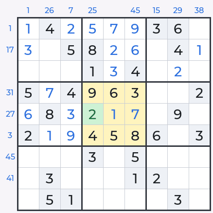

<!-- Written by tools/walkthrough.py x-sums: edit the script, not this page. -->
# X-Sums, step 19: the 2 in box 5

**Step 19 of 51** · [← Step 18](step-18.md) · [All steps](../x-sums.md#the-whole-puzzle-step-by-step) · [Step 20 →](step-20.md)

Box 5 needs a 2, and r5c4 is its last empty cell: **r5c4 = 2**.

**Step 19 of 51** · [← Step 18](step-18.md) · [All steps](../x-sums.md#the-whole-puzzle-step-by-step) · [Step 20 →](step-20.md)
