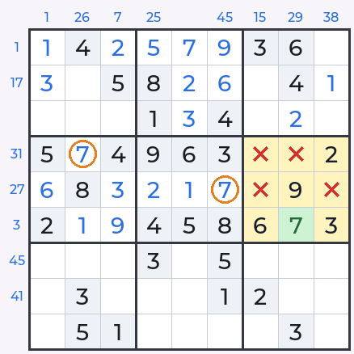

<!-- Written by tools/walkthrough.py x-sums: edit the script, not this page. -->
# X-Sums, step 20: the 7 in box 6

**Step 20 of 51** · [← Step 19](step-19.md) · [All steps](../x-sums.md#the-whole-puzzle-step-by-step) · [Step 21 →](step-21.md)

Box 6 needs a 7. r4c7 and r4c8: row 4 has one (r4c2). r5c7 and r5c9: row 5 has one (r5c6). Only **r6c8** is left: **r6c8 = 7**.

**Step 20 of 51** · [← Step 19](step-19.md) · [All steps](../x-sums.md#the-whole-puzzle-step-by-step) · [Step 21 →](step-21.md)
