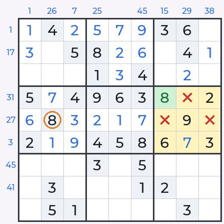

<!-- Written by tools/walkthrough.py x-sums: edit the script, not this page. -->
# X-Sums, step 21: the 8 in box 6

**Step 21 of 51** · [← Step 20](step-20.md) · [All steps](../x-sums.md#the-whole-puzzle-step-by-step) · [Step 22 →](step-22.md)

Box 6 needs an 8. r5c7 and r5c9: row 5 has one (r5c2). r4c8: Column 8 starts with a 6, so its first 6 digits add up to its clue 29, but with an 8 there they come to 36. Only **r4c7** is left: **r4c7 = 8**.

**Step 21 of 51** · [← Step 20](step-20.md) · [All steps](../x-sums.md#the-whole-puzzle-step-by-step) · [Step 22 →](step-22.md)
