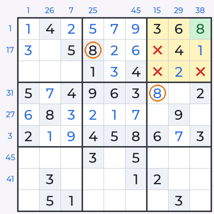

<!-- Written by tools/walkthrough.py x-sums: edit the script, not this page. -->
# X-Sums, step 22: the 8 in box 3

**Step 22 of 51** · [← Step 21](step-21.md) · [All steps](../x-sums.md#the-whole-puzzle-step-by-step) · [Step 23 →](step-23.md)

Box 3 needs an 8. r2c7: row 2 has one (r2c4). r3c7: column 7 has one (r4c7). r3c9: Column 9's clue 38 can't be made up with an 8 there, whatever its first digit. Only **r1c9** is left: **r1c9 = 8**.

**Step 22 of 51** · [← Step 21](step-21.md) · [All steps](../x-sums.md#the-whole-puzzle-step-by-step) · [Step 23 →](step-23.md)
