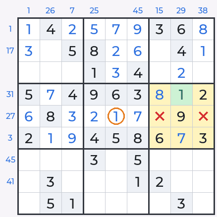

<!-- Written by tools/walkthrough.py x-sums: edit the script, not this page. -->
# X-Sums, step 23: the 1 in box 6

**Step 23 of 51** · [← Step 22](step-22.md) · [All steps](../x-sums.md#the-whole-puzzle-step-by-step) · [Step 24 →](step-24.md)

Box 6 needs a 1. r5c7 and r5c9: row 5 has one (r5c5). Only **r4c8** is left: **r4c8 = 1**.

**Step 23 of 51** · [← Step 22](step-22.md) · [All steps](../x-sums.md#the-whole-puzzle-step-by-step) · [Step 24 →](step-24.md)
