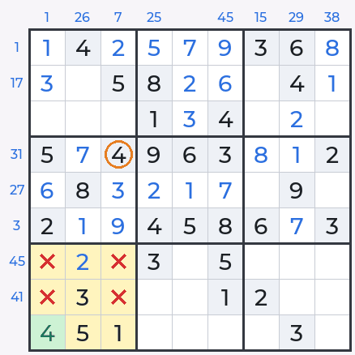

<!-- Written by tools/walkthrough.py x-sums: edit the script, not this page. -->
# X-Sums, step 25: the 4 in box 7

**Step 25 of 51** · [← Step 24](step-24.md) · [All steps](../x-sums.md#the-whole-puzzle-step-by-step) · [Step 26 →](step-26.md)

Box 7 needs a 4. r7c3 and r8c3: column 3 has one (r4c3). r7c1: it's the first cell after a clue, and that clue can only start with a 9. r8c1: it's the first cell after a clue, and that clue can only start with 7 to 8. Only **r9c1** is left: **r9c1 = 4**.

**Step 25 of 51** · [← Step 24](step-24.md) · [All steps](../x-sums.md#the-whole-puzzle-step-by-step) · [Step 26 →](step-26.md)
