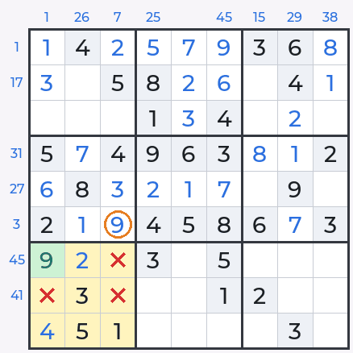

<!-- Written by tools/walkthrough.py x-sums: edit the script, not this page. -->
# X-Sums, step 26: the 9 in box 7

**Step 26 of 51** · [← Step 25](step-25.md) · [All steps](../x-sums.md#the-whole-puzzle-step-by-step) · [Step 27 →](step-27.md)

Box 7 needs a 9. r7c3 and r8c3: column 3 has one (r6c3). r8c1: it's the first cell after a clue, and that clue can only start with 7 to 8. Only **r7c1** is left: **r7c1 = 9**.

**Step 26 of 51** · [← Step 25](step-25.md) · [All steps](../x-sums.md#the-whole-puzzle-step-by-step) · [Step 27 →](step-27.md)
