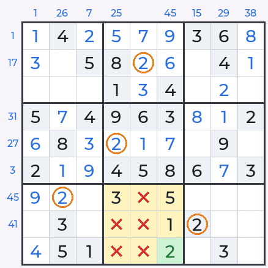

<!-- Written by tools/walkthrough.py x-sums: edit the script, not this page. -->
# X-Sums, step 27: the 2 in box 8

**Step 27 of 51** · [← Step 26](step-26.md) · [All steps](../x-sums.md#the-whole-puzzle-step-by-step) · [Step 28 →](step-28.md)

Box 8 needs a 2. r7c5: row 7 has one (r7c2). r8c4 and r8c5: row 8 has one (r8c7). r9c4: column 4 has one (r5c4). r9c5: column 5 has one (r2c5). Only **r9c6** is left: **r9c6 = 2**.

**Step 27 of 51** · [← Step 26](step-26.md) · [All steps](../x-sums.md#the-whole-puzzle-step-by-step) · [Step 28 →](step-28.md)
