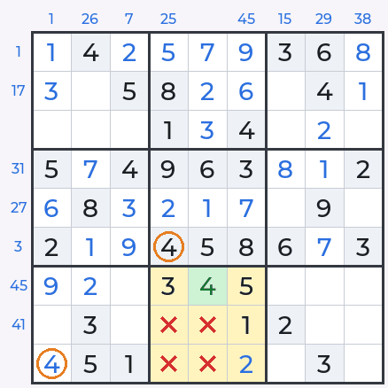

<!-- Written by tools/walkthrough.py x-sums: edit the script, not this page. -->
# X-Sums, step 28: the 4 in box 8

**Step 28 of 51** · [← Step 27](step-27.md) · [All steps](../x-sums.md#the-whole-puzzle-step-by-step) · [Step 29 →](step-29.md)

Box 8 needs a 4. r8c4: column 4 has one (r6c4). r9c4 and r9c5: row 9 has one (r9c1). r8c5: Row 8's clue 41 can't be made up with a 4 there, whatever its first digit. Only **r7c5** is left: **r7c5 = 4**.

**Step 28 of 51** · [← Step 27](step-27.md) · [All steps](../x-sums.md#the-whole-puzzle-step-by-step) · [Step 29 →](step-29.md)
