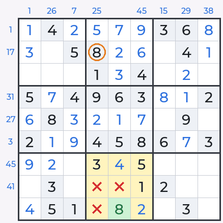

<!-- Written by tools/walkthrough.py x-sums: edit the script, not this page. -->
# X-Sums, step 29: the 8 in box 8

**Step 29 of 51** · [← Step 28](step-28.md) · [All steps](../x-sums.md#the-whole-puzzle-step-by-step) · [Step 30 →](step-30.md)

Box 8 needs an 8. r8c4 and r9c4: column 4 has one (r2c4). r8c5: Row 8's clue 41 can't be made up with an 8 there, whatever its first digit. Only **r9c5** is left: **r9c5 = 8**.

**Step 29 of 51** · [← Step 28](step-28.md) · [All steps](../x-sums.md#the-whole-puzzle-step-by-step) · [Step 30 →](step-30.md)
