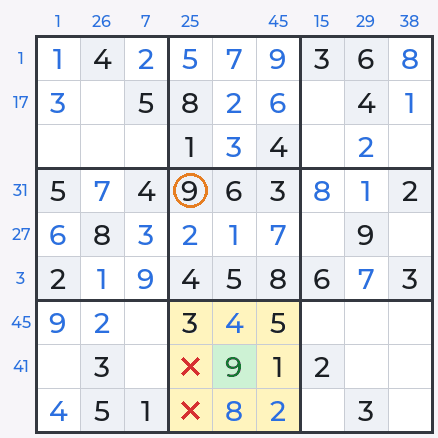

<!-- Written by tools/walkthrough.py x-sums: edit the script, not this page. -->
# X-Sums, step 30: the 9 in box 8

**Step 30 of 51** · [← Step 29](step-29.md) · [All steps](../x-sums.md#the-whole-puzzle-step-by-step) · [Step 31 →](step-31.md)

Box 8 needs a 9. r8c4 and r9c4: column 4 has one (r4c4). Only **r8c5** is left: **r8c5 = 9**.

**Step 30 of 51** · [← Step 29](step-29.md) · [All steps](../x-sums.md#the-whole-puzzle-step-by-step) · [Step 31 →](step-31.md)
