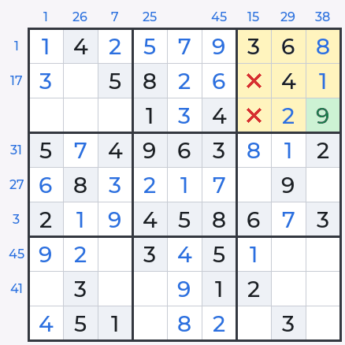

<!-- Written by tools/walkthrough.py x-sums: edit the script, not this page. -->
# X-Sums, step 32: the 9 in box 3

**Step 32 of 51** · [← Step 31](step-31.md) · [All steps](../x-sums.md#the-whole-puzzle-step-by-step) · [Step 33 →](step-33.md)

Box 3 needs a 9. r2c7 and r3c7: Column 7 starts with a 3, so its first 3 digits add up to its clue 15: with a 9 there, its other empty cell would need 3, which can't be made with digits not there yet. Only **r3c9** is left: **r3c9 = 9**.

**Step 32 of 51** · [← Step 31](step-31.md) · [All steps](../x-sums.md#the-whole-puzzle-step-by-step) · [Step 33 →](step-33.md)
