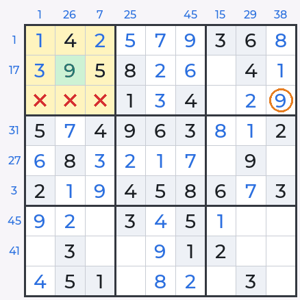

<!-- Written by tools/walkthrough.py x-sums: edit the script, not this page. -->
# X-Sums, step 33: the 9 in box 1

**Step 33 of 51** · [← Step 32](step-32.md) · [All steps](../x-sums.md#the-whole-puzzle-step-by-step) · [Step 34 →](step-34.md)

Box 1 needs a 9. r3c1, r3c2 and r3c3: row 3 has one (r3c9). Only **r2c2** is left: **r2c2 = 9**.

**Step 33 of 51** · [← Step 32](step-32.md) · [All steps](../x-sums.md#the-whole-puzzle-step-by-step) · [Step 34 →](step-34.md)
