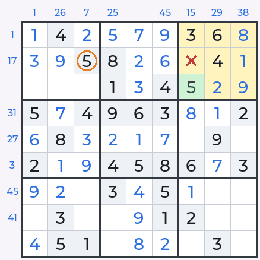

<!-- Written by tools/walkthrough.py x-sums: edit the script, not this page. -->
# X-Sums, step 34: the 5 in box 3

**Step 34 of 51** · [← Step 33](step-33.md) · [All steps](../x-sums.md#the-whole-puzzle-step-by-step) · [Step 35 →](step-35.md)

Box 3 needs a 5. r2c7: row 2 has one (r2c3). Only **r3c7** is left: **r3c7 = 5**.

**Step 34 of 51** · [← Step 33](step-33.md) · [All steps](../x-sums.md#the-whole-puzzle-step-by-step) · [Step 35 →](step-35.md)
