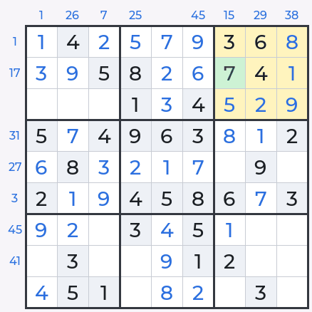

<!-- Written by tools/walkthrough.py x-sums: edit the script, not this page. -->
# X-Sums, step 35: the 7 in box 3

**Step 35 of 51** · [← Step 34](step-34.md) · [All steps](../x-sums.md#the-whole-puzzle-step-by-step) · [Step 36 →](step-36.md)

Box 3 needs a 7, and r2c7 is its last empty cell: **r2c7 = 7**.

**Step 35 of 51** · [← Step 34](step-34.md) · [All steps](../x-sums.md#the-whole-puzzle-step-by-step) · [Step 36 →](step-36.md)
