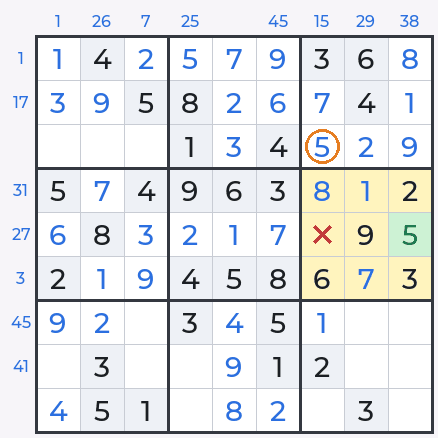

<!-- Written by tools/walkthrough.py x-sums: edit the script, not this page. -->
# X-Sums, step 36: the 5 in box 6

**Step 36 of 51** · [← Step 35](step-35.md) · [All steps](../x-sums.md#the-whole-puzzle-step-by-step) · [Step 37 →](step-37.md)

Box 6 needs a 5. r5c7: column 7 has one (r3c7). Only **r5c9** is left: **r5c9 = 5**.

**Step 36 of 51** · [← Step 35](step-35.md) · [All steps](../x-sums.md#the-whole-puzzle-step-by-step) · [Step 37 →](step-37.md)
