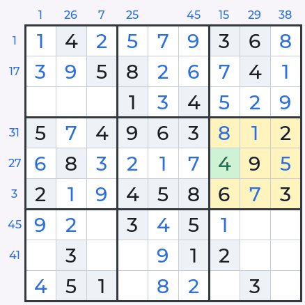

<!-- Written by tools/walkthrough.py x-sums: edit the script, not this page. -->
# X-Sums, step 37: the 4 in box 6

**Step 37 of 51** · [← Step 36](step-36.md) · [All steps](../x-sums.md#the-whole-puzzle-step-by-step) · [Step 38 →](step-38.md)

Box 6 needs a 4, and r5c7 is its last empty cell: **r5c7 = 4**.

**Step 37 of 51** · [← Step 36](step-36.md) · [All steps](../x-sums.md#the-whole-puzzle-step-by-step) · [Step 38 →](step-38.md)
