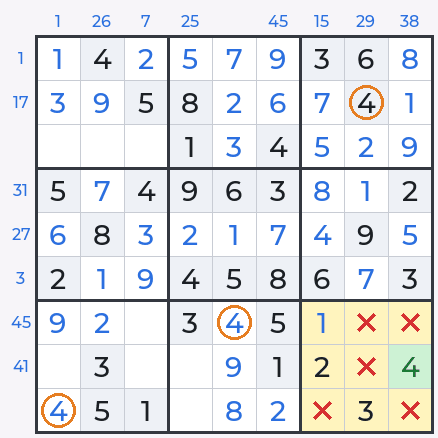

<!-- Written by tools/walkthrough.py x-sums: edit the script, not this page. -->
# X-Sums, step 38: the 4 in box 9

**Step 38 of 51** · [← Step 37](step-37.md) · [All steps](../x-sums.md#the-whole-puzzle-step-by-step) · [Step 39 →](step-39.md)

Box 9 needs a 4. r7c8 and r7c9: row 7 has one (r7c5). r8c8: column 8 has one (r2c8). r9c7 and r9c9: row 9 has one (r9c1). Only **r8c9** is left: **r8c9 = 4**.

**Step 38 of 51** · [← Step 37](step-37.md) · [All steps](../x-sums.md#the-whole-puzzle-step-by-step) · [Step 39 →](step-39.md)
