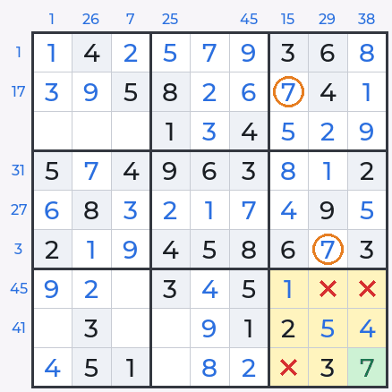

<!-- Written by tools/walkthrough.py x-sums: edit the script, not this page. -->
# X-Sums, step 40: the 7 in box 9

**Step 40 of 51** · [← Step 39](step-39.md) · [All steps](../x-sums.md#the-whole-puzzle-step-by-step) · [Step 41 →](step-41.md)

Box 9 needs a 7. r7c8: column 8 has one (r6c8). r9c7: column 7 has one (r2c7). r7c9: Column 9 starts with an 8, so its first 8 digits add up to its clue 38, but with a 7 there they come to 39. Only **r9c9** is left: **r9c9 = 7**.

**Step 40 of 51** · [← Step 39](step-39.md) · [All steps](../x-sums.md#the-whole-puzzle-step-by-step) · [Step 41 →](step-41.md)
