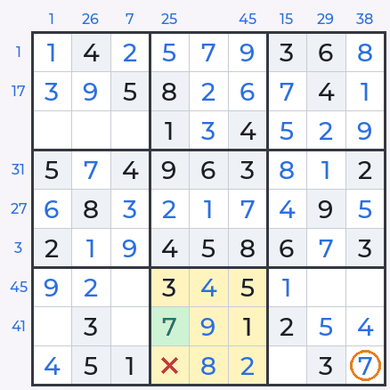

<!-- Written by tools/walkthrough.py x-sums: edit the script, not this page. -->
# X-Sums, step 41: the 7 in box 8

**Step 41 of 51** · [← Step 40](step-40.md) · [All steps](../x-sums.md#the-whole-puzzle-step-by-step) · [Step 42 →](step-42.md)

Box 8 needs a 7. r9c4: row 9 has one (r9c9). Only **r8c4** is left: **r8c4 = 7**.

**Step 41 of 51** · [← Step 40](step-40.md) · [All steps](../x-sums.md#the-whole-puzzle-step-by-step) · [Step 42 →](step-42.md)
