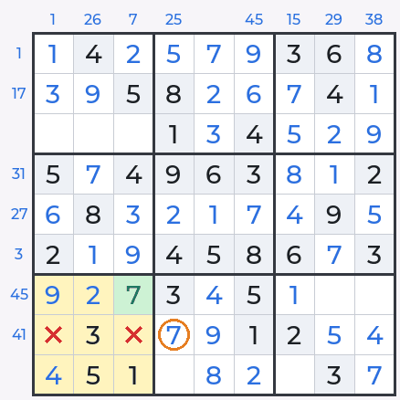

<!-- Written by tools/walkthrough.py x-sums: edit the script, not this page. -->
# X-Sums, step 42: the 7 in box 7

**Step 42 of 51** · [← Step 41](step-41.md) · [All steps](../x-sums.md#the-whole-puzzle-step-by-step) · [Step 43 →](step-43.md)

Box 7 needs a 7. r8c1 and r8c3: row 8 has one (r8c4). Only **r7c3** is left: **r7c3 = 7**.

**Step 42 of 51** · [← Step 41](step-41.md) · [All steps](../x-sums.md#the-whole-puzzle-step-by-step) · [Step 43 →](step-43.md)
