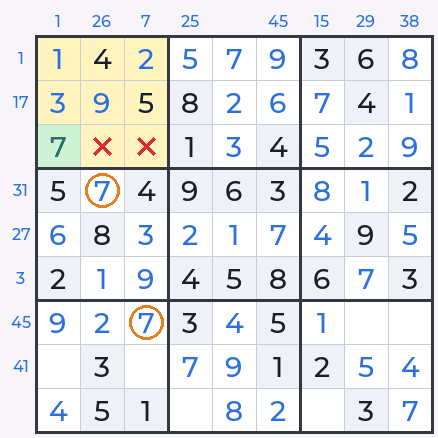

<!-- Written by tools/walkthrough.py x-sums: edit the script, not this page. -->
# X-Sums, step 43: the 7 in box 1

**Step 43 of 51** · [← Step 42](step-42.md) · [All steps](../x-sums.md#the-whole-puzzle-step-by-step) · [Step 44 →](step-44.md)

Box 1 needs a 7. r3c2: column 2 has one (r4c2). r3c3: column 3 has one (r7c3). Only **r3c1** is left: **r3c1 = 7**.

**Step 43 of 51** · [← Step 42](step-42.md) · [All steps](../x-sums.md#the-whole-puzzle-step-by-step) · [Step 44 →](step-44.md)
