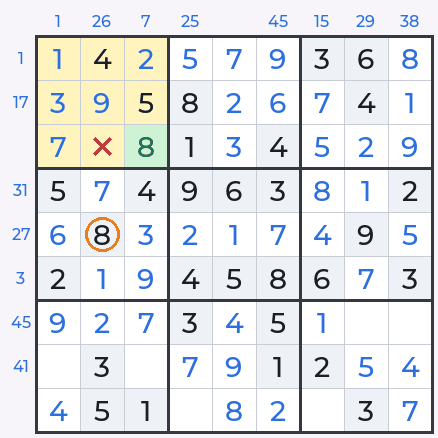

<!-- Written by tools/walkthrough.py x-sums: edit the script, not this page. -->
# X-Sums, step 44: the 8 in box 1

**Step 44 of 51** · [← Step 43](step-43.md) · [All steps](../x-sums.md#the-whole-puzzle-step-by-step) · [Step 45 →](step-45.md)

Box 1 needs an 8. r3c2: column 2 has one (r5c2). Only **r3c3** is left: **r3c3 = 8**.

**Step 44 of 51** · [← Step 43](step-43.md) · [All steps](../x-sums.md#the-whole-puzzle-step-by-step) · [Step 45 →](step-45.md)
