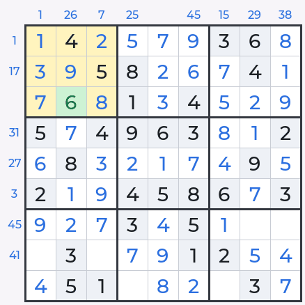

<!-- Written by tools/walkthrough.py x-sums: edit the script, not this page. -->
# X-Sums, step 45: the 6 in box 1

**Step 45 of 51** · [← Step 44](step-44.md) · [All steps](../x-sums.md#the-whole-puzzle-step-by-step) · [Step 46 →](step-46.md)

Box 1 needs a 6, and r3c2 is its last empty cell: **r3c2 = 6**.

**Step 45 of 51** · [← Step 44](step-44.md) · [All steps](../x-sums.md#the-whole-puzzle-step-by-step) · [Step 46 →](step-46.md)
